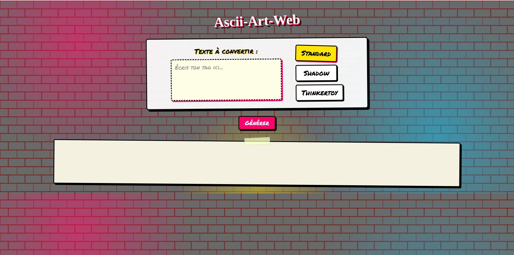
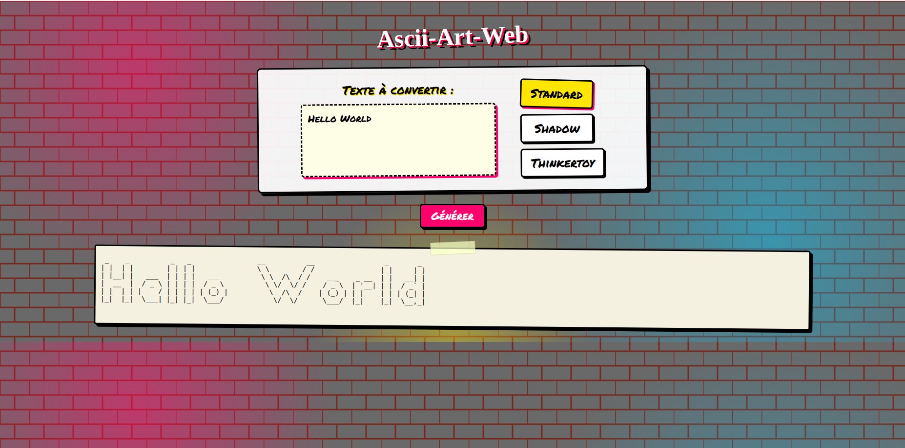

# ASCII Art Web

A web application written in Go that converts a text into ASCII art, using different banner styles, through a simple web page.

## Features

- Web interface to type a text and choose a banner
- Three banner styles: `standard`, `shadow`, `thinkertoy`
- Supports printable ASCII characters (from space to `~`)
- Runs locally with Go or inside a Docker container

## Preview

**Home page:**



**Result with "Hello World" (standard banner):**



## Requirements

- Go 1.22.2 or later
- Docker (optional)

## Usage

From the project folder:

```bash
go run .
```

Then open [http://localhost:8080](http://localhost:8080) in your browser.

1. Type your text in the input field
2. Choose a banner
3. Submit to see the ASCII art result

## Routes

| Method | Route        | Description                                      |
|--------|--------------|--------------------------------------------------|
| GET    | `/`          | Displays the home page                           |
| POST   | `/ascii-art` | Converts the text with the chosen banner and displays the result |

## How it works

Each banner file (for example `standard.txt`) describes every printable character (from space to `~`) with 8 lines of text, followed by an empty separator line, so 9 lines per character.

For each character of the input text, the program:

1. Uses its ASCII code to compute its position in the banner file
2. Extracts the 8 corresponding lines
3. Joins them horizontally with the other characters to build the final drawing

## Docker

Build the image:

```bash
docker build -t ascii-art-web:2.0 .
```

Run the container:

```bash
docker run -d -p 8080:8080 --rm --name ascii-web \
  --label fr.zone01.titre="ascii-art-web container" \
  --label fr.zone01.version="2.0" \
  ascii-art-web:2.0
```

Check that it works:

```bash
docker ps
docker logs ascii-web
docker inspect --format '{{json .Config.Labels}}' ascii-web
docker inspect --format '{{json .Config.Labels}}' ascii-art-web:2.0
```

Stop the container:

```bash
docker stop ascii-web
```

Clean up:

```bash
docker rmi ascii-art-web:2.0
docker image prune
docker system df
```

## Tests

```bash
go test ./...
```

## Project structure

```
.
├── ascii-art
│   ├── asciiart.go
│   ├── asciiart_test.go
│   ├── shadow.txt
│   ├── standard.txt
│   └── thinkertoy.txt
├── Dockerfile
├── go.mod
├── images
│   ├── Hello_World.png
│   └── home.png
├── main.go
├── README.md
├── shadow.txt
├── standard.txt
├── static
│   └── style.css
├── templates
│   └── index.html
└── thinkertoy.txt
```

## Author

swannsavary